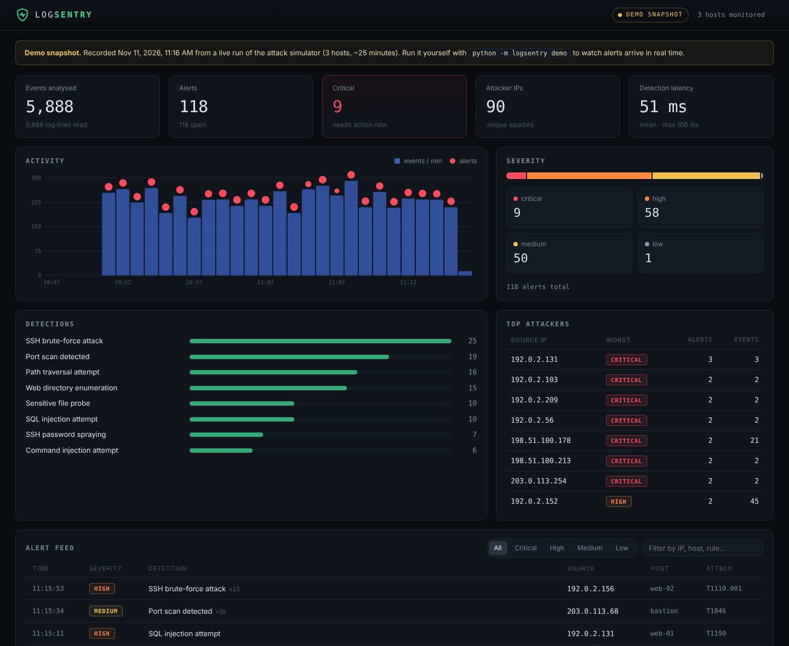
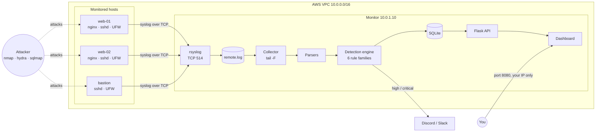

# LogSentry

**A lightweight security monitoring platform (mini SIEM) that collects logs from Linux servers, detects attacks in real time, and alerts you.**

[](https://github.com/Harsh-compiles/logsentry/actions/workflows/ci.yml)


**[Live dashboard demo](https://harsh-compiles.github.io/logsentry/)** · [Deploy on AWS](docs/DEPLOY_AWS.md) · [Attack playbook](docs/ATTACK_PLAYBOOK.md)



LogSentry watches SSH, sudo, firewall and web server logs from several machines, runs them through detection rules mapped to **MITRE ATT&CK**, and raises alerts for brute-force attacks, account compromise, port scans, SQL injection, XSS, path traversal, command injection, directory enumeration and privilege escalation. Alerts appear on a live dashboard and can be pushed to Discord or Slack.

It is deployed with **Terraform** on **AWS**: one monitor server plus three monitored servers that forward their logs over **rsyslog**. The detection engine runs in **Docker**, and **GitHub Actions** tests every commit.

---

## Results

Measured with `python scripts/evaluate.py` and the live demo:

| Metric | Result |
|---|---|
| Attack scenarios detected (10 attack types × 200 randomized runs) | **100%** |
| False positives on 24 h of simulated normal traffic (~250,000 log lines) | **0** |
| Detection latency, log line written → alert raised (live pipeline, 118 alerts) | **51 ms mean, 106 ms max** |
| Engine throughput (single core) | **~78,000 lines/s** |
| Tests | 50 unit and integration tests |

> The simulated attacks were written alongside the rules, so 100% shows the rules work as designed, not that they catch everything in the wild. See [Limitations](#limitations).

---

## Architecture



1. **Collection.** Each monitored server forwards *all* its logs (auth, sudo, kernel firewall, nginx) to the monitor with rsyslog over TCP, using a disk-backed queue so nothing is lost if the monitor restarts.
2. **Parsing.** `parsers.py` auto-detects each line's format (sshd, sudo, UFW/iptables, nginx combined, plain or syslog-wrapped) and turns it into a structured event. URL payloads are decoded twice to catch double-encoding.
3. **Detection.** `rules.py` keeps per-IP sliding time windows and checks thresholds and signatures. Repeat alerts for the same attacker are merged into one alert with a count, so the feed stays readable.
4. **Storage and alerting.** Alerts go to SQLite, the console, and optionally a webhook (sent on a background thread so a slow webhook never delays detection).
5. **Dashboard.** A dependency-free HTML/JS page polls the API every 3 seconds. All log content is HTML-escaped, because log lines are attacker-controlled (the XSS payloads it detects would otherwise run in your dashboard).

## Detections

| Rule | Triggers when | Severity | MITRE ATT&CK |
|---|---|---|---|
| SSH brute force | ≥ 5 failed logins from one IP within 60 s | High | [T1110.001](https://attack.mitre.org/techniques/T1110/001/) |
| SSH password spraying | the same, across more than 3 usernames | High | [T1110.003](https://attack.mitre.org/techniques/T1110/003/) |
| Compromise after brute force | successful login from an IP that just brute-forced | **Critical** | [T1078](https://attack.mitre.org/techniques/T1078/) |
| Port scan | ≥ 15 distinct blocked ports from one IP within 60 s | Medium | [T1046](https://attack.mitre.org/techniques/T1046/) |
| SQL injection | `UNION SELECT`, `' OR 1=1`, `SLEEP()`, `information_schema`… | High | [T1190](https://attack.mitre.org/techniques/T1190/) |
| Cross-site scripting | `<script>`, `onerror=`, `javascript:`… | Medium | [T1190](https://attack.mitre.org/techniques/T1190/) |
| Path traversal | `../`, `/etc/passwd`… | High | [T1083](https://attack.mitre.org/techniques/T1083/) |
| Command injection | `;id`, `\|cat`, `$(…)`, backticks | **Critical** | [T1059](https://attack.mitre.org/techniques/T1059/) |
| Sensitive file probe | `/.env`, `/.git/`, `wp-config.php`… | Medium | [T1552.001](https://attack.mitre.org/techniques/T1552/001/) |
| Directory enumeration | ≥ 20 4xx responses to one IP within 60 s | Medium | [T1595.003](https://attack.mitre.org/techniques/T1595/003/) |
| Service account sudo | `www-data`, `nginx`, `postgres`… running sudo (likely web shell) | **Critical** | [T1548.003](https://attack.mitre.org/techniques/T1548/003/) |
| Unauthorized sudo | user not in sudoers tries sudo | Medium | [T1548.003](https://attack.mitre.org/techniques/T1548/003/) |
| Root shell via sudo | `sudo bash`, `sudo su`, reading `/etc/shadow`… | Low | [T1548.003](https://attack.mitre.org/techniques/T1548/003/) |

Known scanners (sqlmap, nikto, nmap, gobuster, wpscan, nuclei, hydra…) are named in the alert when their user agent appears. Thresholds are in `RuleConfig` in `logsentry/rules.py`.

---

## Quick start (no servers needed)

```bash
git clone https://github.com/Harsh-compiles/logsentry.git
cd logsentry
pip install -r requirements.txt

python -m logsentry demo          # open http://localhost:8080
```

The demo starts the attack simulator, which writes realistic sshd, sudo, firewall and nginx logs to a file. The collector tails that file and alerts appear on the dashboard within a fraction of a second, exactly as they would in production.

With Docker:

```bash
docker compose up demo            # http://localhost:8080
```

Other commands:

```bash
# Analyse existing log files and print the alerts
python -m logsentry replay samples/attack-sample.log
python -m logsentry replay /var/log/auth.log /var/log/nginx/access.log --json alerts.json

# Watch real logs live
python -m logsentry run --logs /var/log/auth.log /var/log/nginx/access.log

# Send high and critical alerts to Discord
LOGSENTRY_WEBHOOK="https://discord.com/api/webhooks/..." python -m logsentry demo
```

## Deploy the full lab on AWS

```bash
cd infra/terraform
cp terraform.tfvars.example terraform.tfvars    # add your IP and SSH key
terraform init && terraform apply
```

This creates a VPC, security groups, the monitor and three monitored servers (all free-tier sizes), configures rsyslog forwarding, hardens SSH and the host firewall, and starts LogSentry in Docker. The dashboard is only reachable from your IP. Full walkthrough: **[docs/DEPLOY_AWS.md](docs/DEPLOY_AWS.md)**.

Once it is running, attack your own servers with nmap, hydra, gobuster and sqlmap and watch the detections: **[docs/ATTACK_PLAYBOOK.md](docs/ATTACK_PLAYBOOK.md)**. Because SSH is open to the internet (key-only), real bots usually start brute-forcing within minutes, so you will see genuine attacks too.

`terraform destroy` removes everything.

---

## API

| Method | Endpoint | Description |
|---|---|---|
| GET | `/api/health` | Liveness check |
| GET | `/api/dashboard` | Stats, timeline, alerts and rule catalogue in one call |
| GET | `/api/alerts?severity=high&limit=50` | Alert list |
| POST | `/api/alerts/<id>/status` | `{"status": "acknowledged" \| "resolved" \| "false_positive"}`. Requires `Authorization: Bearer <token>` when `LOGSENTRY_API_TOKEN` is set |

## Configuration

| Variable | Default | Purpose |
|---|---|---|
| `LOGSENTRY_LOGS` | | Comma-separated log files to follow (`run`) |
| `LOGSENTRY_WEBHOOK` | | Discord or Slack webhook URL |
| `LOGSENTRY_ALERT_LEVEL` | `high` | Minimum severity sent to the webhook |
| `LOGSENTRY_API_TOKEN` | | Token required to change alert status |
| `LOGSENTRY_DB` | `logsentry.db` | SQLite database path |
| `LOGSENTRY_HOST` / `LOGSENTRY_PORT` | `127.0.0.1` / `8080` | Dashboard address |

## Security design

- **Least exposure.** The dashboard and monitor SSH are restricted to your IP by the AWS security group (Terraform refuses `0.0.0.0/0`). Syslog port 514 only accepts traffic from the monitored hosts' security group.
- **Hardened hosts.** Key-only SSH, no root login, `MaxAuthTries 3`, UFW default-deny, IMDSv2 only, encrypted disks.
- **Hardened container.** Non-root user, read-only filesystem, all Linux capabilities dropped, `no-new-privileges`, logs mounted read-only.
- **Safe dashboard.** Every log-derived value is HTML-escaped; strict Content-Security-Policy (`script-src 'self'`), `X-Frame-Options: DENY`, `nosniff`.
- **No secrets in git.** Webhook and token come from Terraform variables marked `sensitive` and land in a `0600` env file on the server; `terraform.tfvars` is git-ignored.

## Project structure

```
logsentry/
  parsers.py      log formats -> structured events
  rules.py        detection rules, sliding windows, MITRE mapping
  engine.py       runs rules, merges duplicate alerts
  collector.py    tail -F with log-rotation handling
  store.py        SQLite storage and dashboard statistics
  notifier.py     console + Discord/Slack webhooks
  api.py          Flask REST API + security headers
  simulate.py     realistic attack and background log generator
dashboard/        static HTML/CSS/JS dashboard (also deployed to GitHub Pages)
infra/terraform/  AWS VPC, security groups, EC2 instances, bootstrap scripts
deploy/           rsyslog, nginx and logrotate configs
tests/            pytest suite
scripts/          evaluation script
samples/          sample attack log for replay
```

## Development

```bash
pip install -r requirements-dev.txt
ruff check .
pytest -v
python scripts/evaluate.py
```

## Limitations

Honest notes on what this does not catch, and what I would add next:

- **Low-and-slow attacks.** A brute force with one guess every two minutes stays under the 60-second window (there is a test documenting this). Fix: per-IP baselines over hours.
- **Signature evasion.** Web detection is pattern-based, so heavily obfuscated payloads can slip past. Fix: parse query parameters and add an anomaly score, or feed alerts to a WAF.
- **Single node.** One SQLite database on one monitor. For more hosts, move to a queue (e.g. Kafka) and a search store (OpenSearch).
- **No automatic response.** Next step: optional auto-blocking of critical-severity IPs with `ufw deny` or AWS network ACLs, with an allowlist.

## License

MIT
